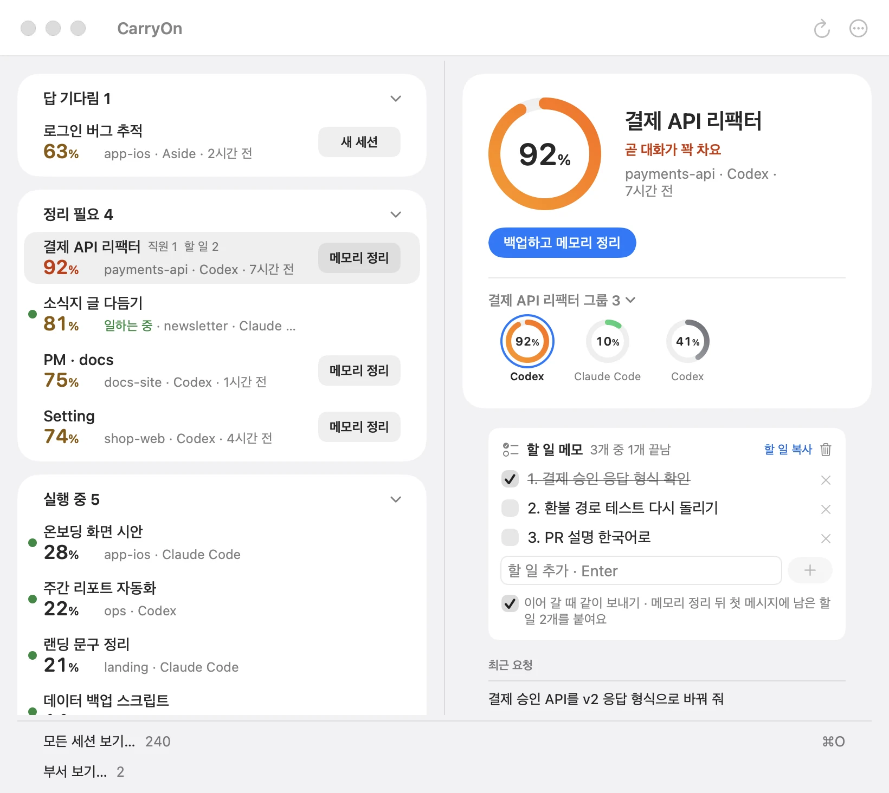
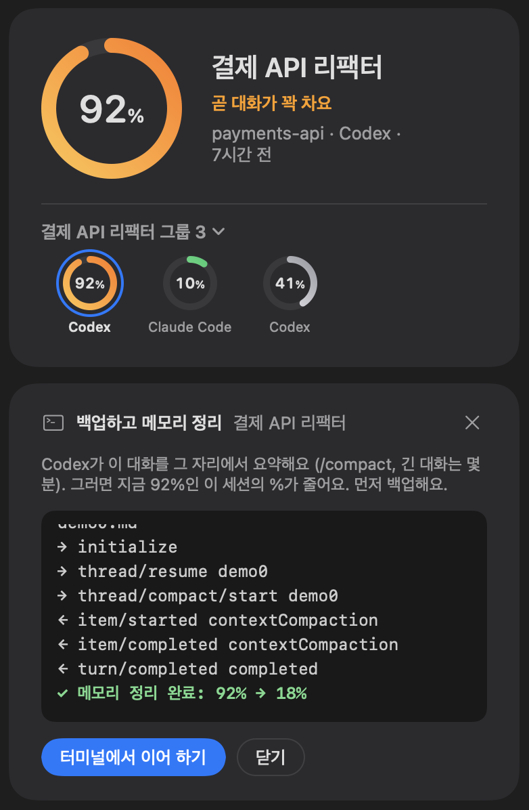

# CarryOn

[English](README.md) | 한국어

컴퓨터에 있는 모든 AI 코딩 세션(Claude Code, Codex, Aside, Gemini CLI)과 세션마다 컨텍스트가 얼마나 찼는지 보여 주는 무료
앱이에요. 거의 다 찬 세션은 버튼 하나로 백업하고 메모리를 정리해서, 하던 일을 그 자리에서 이어 갈 수 있어요.
**맥·윈도우·아이폰·안드로이드 다 무료예요.**

**새 소식:** iPhone 앱이 App Store에 나왔어요.

**다운로드:** [Mac](https://carryon-app.pages.dev/download?s=github) · [Windows (Microsoft Store)](https://carryon-app.pages.dev/download/windows?s=github) · [iPhone (App Store)](https://apps.apple.com/app/id6831468074?ct=github) · [Android (시험판 테스터 모집)](https://carryon-app.pages.dev/?lang=ko&s=github#android) · [웹사이트](https://carryon-app.pages.dev/?lang=ko&s=github)

- Mac: macOS 14 이상, Apple 칩·인텔
- Windows: Windows 10 1903 이상, x64. Microsoft Store에서 받아요
- iPhone: iOS 15 이상. 휴대폰 앱이라 컴퓨터에 CarryOn이 있어야 해요
- Android (Google Play 비공개 테스트): Android 7 이상. 참여하려면 Gmail 계정으로 [Google 그룹에 가입](https://groups.google.com/g/carryon-android-testers)한 뒤
  [여기서 테스트에 참여](https://play.google.com/apps/testing/io.github.carryon.phone)하면 돼요. 시험판 APK는 [여기](https://carryon-app.pages.dev/download/android?s=github)에서도 받을 수 있어요

<picture>
  <source media="(prefers-color-scheme: dark)" srcset="docs/img/ko-wide-dark.webp">
  
</picture>

- **챙길 세션만 한 목록에.** 답 기다림, 정리 필요(컨텍스트 60% 이상은 노랑, 85%부터 주황), 실행 중. 세션마다 한
  번씩만 카드로 보여요. 고른 세션의 카드에는 그 그룹이 링으로 보여요. 그룹은 일을 시킨 세션과 그 세션이 직접 일을 맡긴
  세션들이고, 이름은 일을 시킨 세션의 이름이에요. 그룹 이름을 누르면 모든 그룹이 가장 많이 찬 순서로 나와요. 거의 다
  차면 알림이 와요.
- **백업하고 메모리 정리.** 대화를 백업한 뒤 그 자리에서 압축해서 그 세션의 %를 줄여요. 앱이 패널에서 직접 실행하고,
  단계마다 걸린 시간을 보여 줘요. Aside·Gemini CLI 세션은 새 세션에서 이어 가요.
  CarryOn은 실행 중인 세션을 끄거나 새 창으로 다시 열지 않아요. 설정에서 **메모리 차면 자동 정리**를 켜 두면 Claude
  Code와 Codex가 빨간 선에 닿을 때 그 자리에서 스스로 메모리를 정리해요. CarryOn은 두 도구의 설정에 그 값 하나만 써
  두고, 끄면 원래대로 되돌려요. 일하는 중인 세션은 **끝나면 정리**를 예약해 두면 일이 멈춘 뒤 정리하고 알려 줘요.

  

- **버튼 한 번이면 그 자리에서.** 실행 중인 Claude Code 세션에서 **백업하고 메모리 정리**를 누르면 CarryOn이 그 터미널
  (Terminal·tmux·WezTerm·원격 제어를 켠 kitty·Orca)에 `/compact`를 직접 넣어 정리해요. 세션은 그대로 열려 있고 기억을
  이어 가요. 일하는 중에 눌러 두면 세션이 멈추는 순간 바로 정리해요.
- **기억 지킴.** 켜 두면 Claude Code가 스스로 압축할 때도 직전 대화를 14일 보관하고, 역할·남은 할 일·‘꼭 기억할 것’을
  압축 뒤에 다시 넣어 줘요.
- **폰에서는 한 번 탭.** 폰 알림의 [메모리 정리]를 누르면 컴퓨터가 바로 정리해요.
- **Orca 안에서 새 세션으로.** Orca 칸에서 실행 중인 Claude Code(또는 Codex)에서 **백업하고 새 세션으로**를 누르면
  백업한 뒤 그 칸에 `/clear`(Codex는 `/new`)와 이어 가기 글을 넣어 같은 칸에서 새 세션으로 이어 가요. 실행 중인 세션에
  입력하는 건 이때뿐이에요. 버튼을 눌렀을 때, 세션이 쉬고 있고 입력줄이 비어 있을 때만요.
- **세션 정리.** 터미널에 열어 둔 채 쉬고 있는 Claude Code 세션을 차지한 메모리와 함께 보여 주고, 확인을 받은 뒤에만
  꺼요(대화는 남아서 다시 이어 갈 수 있어요). 24시간 동안 토큰을 많이 읽은 세션도 모아서 그 줄에서 바로 정리할 수 있게 해 줘요.
- **할 일 메모도 함께 넘어가요.** 세션마다 할 일을 적어 두면, 메모리 정리 뒤에도 남은 할 일이 따라가요.
- **이름 바꾸기.** 세션을 오른쪽 클릭해 ‘이름 바꾸기…’를 고르면 돼요. 바꾼 이름은 CarryOn에만 저장돼요.
- **역할과 부서.** ‘역할 정하기…’로 세션에 역할을 주면 ‘이어서’ 메시지와 이어 가기 안내에 함께 넘어가요. ‘부서 이름
  정하기…’로 그룹에 이름을 붙이고, ‘부서 보기…’에서 부서마다 역할을 한눈에 봐요. CarryOn에만 저장돼요.
- **메뉴 막대에서.** 메뉴 막대의 CarryOn을 클릭하면 창이 열려요. 오른쪽 클릭하면 가장 많이 찬 세션 3개와 설정, 업데이트
  확인이 나와요. 업데이트 확인은 브라우저에서 릴리스 페이지를 열어요.
- 영어, 한국어, 일본어, 중국어(간체), 독일어, 프랑스어, 스페인어, 이탈리아어, 네덜란드어, 포르투갈어(브라질)로 쓸 수 있어요.

## 설치

가장 빠른 방법은 터미널 한 줄이에요. 최신 릴리스를 받아 SHA-256을 릴리스와 대조하고, 실행 중인 CarryOn은 끈 뒤
응용 프로그램 폴더에 넣어요([먼저 읽어 보기](https://carryon-app.pages.dev/install.sh)).

```sh
curl -fsSL https://carryon-app.pages.dev/install.sh | sh
```

`.dmg`로 받아도 돼요. CarryOn은 Apple 공증을 받은 앱이에요.

1. `.dmg`를 열고 **CarryOn**을 **응용 프로그램** 폴더로 끌어다 놓으세요.
2. 앱을 열면 처음 한 번만 macOS가 물어요. **열기**를 누르면 돼요.

Dock 아이콘은 없어요. 메뉴 막대에서 찾으세요.

## 개인정보

- CarryOn은 Mac에 이미 있는 세션 기록만 읽고, 기본으로 CarryOn 자체는 네트워크에 연결하지 않아요.
- **폰 연결**을 켜면 같은 네트워크에서 연결한 폰하고만 암호화해서 통신하고, 세션 이름·찬 정도·상태만 보내요. 대화 내용은 보내지 않아요.
- 메시지 본문은 전체를 보여 주지도, 저장하거나 보내지도 않아요.
- **백업하고 메모리 정리**(또는 **백업하고 새 세션으로**)를 누를 때만 그 세션 하나의 기록을 `~/.carryon/backups/`에
  복사하고 그 도구의 `/compact`(claude 또는 codex)를 실행해요. `/compact`를 직접 입력할 때처럼 정리 결과가 그 세션
  기록에 더해지고, 대화는 요약을 위해 모델 제공자에게 보내져요.
- Orca 칸의 **백업하고 새 세션으로**는 Orca 자체 명령으로 그 칸의 화면을 읽어, 세션이 쉬고 있고 입력줄이 비었는지
  확인한 뒤에만 입력해요.

## 라이선스

CarryOn은 무료지만 오픈소스가 아닙니다. 복제·재배포·수정·판매는 할 수 없습니다([LICENSE](LICENSE), [한국어 번역](LICENSE.ko.md)). ‘CarryOn’과 해달 아이콘은 morningverse의 상표입니다.
