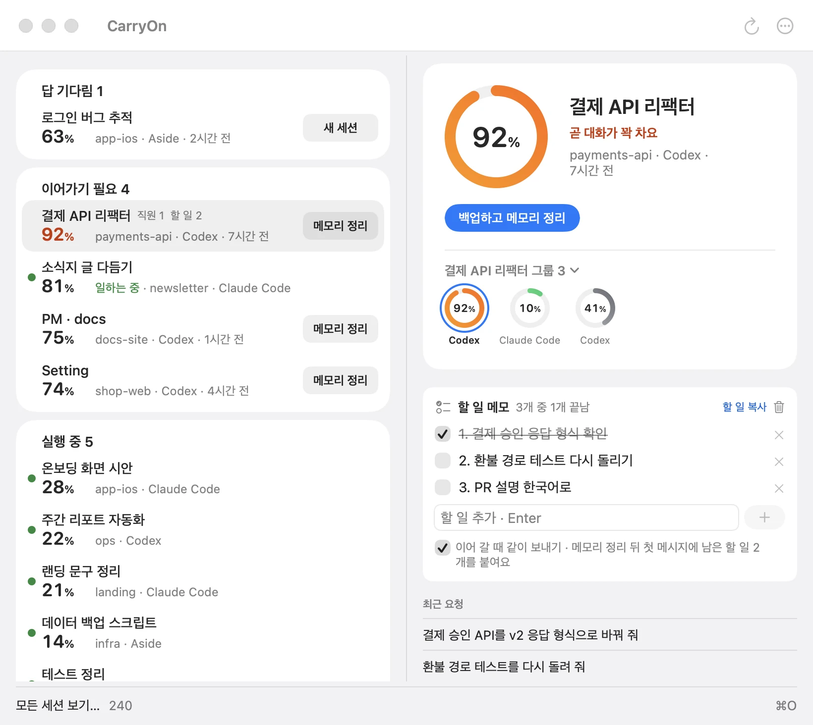
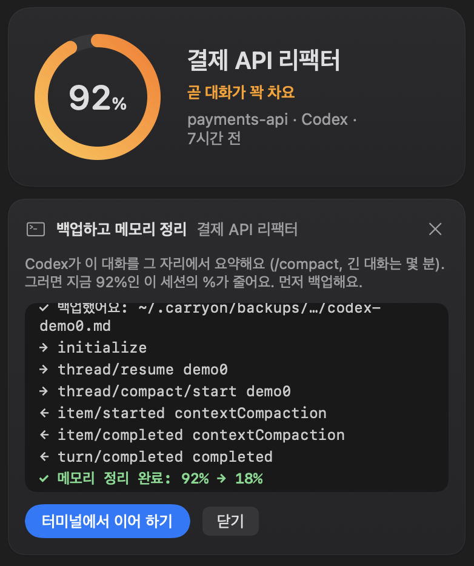

# CarryOn

[English](README.md) | 한국어

Mac에 있는 모든 AI 코딩 세션(Claude Code, Codex, Aside)과 세션마다 컨텍스트가 얼마나 찼는지 보여 주는 무료 메뉴 막대
앱이에요. 거의 다 찬 세션은 버튼 하나로 백업하고 메모리를 정리해서, 하던 일을 그 자리에서 이어 갈 수 있어요.

**[Mac용 CarryOn 다운로드](https://carryon-app.pages.dev/download)**
· macOS 14 이상 · Apple 칩·인텔 · [웹사이트](https://carryon-app.pages.dev/?lang=ko)

<picture>
  <source media="(prefers-color-scheme: dark)" srcset="docs/img/ko-wide-dark.webp">
  
</picture>

- **챙길 세션만 한 목록에.** 답 기다림, 정리 필요(컨텍스트 60% 이상은 노랑, 85%부터 주황), 실행 중. 세션마다 한
  번씩만 카드로 보여요. 고른 세션의 카드에는 그 그룹이 링으로 보여요. 그룹은 일을 시킨 세션과 그 세션이 직접 일을 맡긴
  세션들이고, 이름은 일을 시킨 세션의 이름이에요. 그룹 이름을 누르면 모든 그룹이 가장 많이 찬 순서로 나와요. 거의 다
  차면 알림이 와요.
- **백업하고 메모리 정리.** 대화를 백업한 뒤 그 자리에서 압축해서 그 세션의 %를 줄여요. 앱이 패널에서 직접 실행하고,
  단계마다 걸린 시간을 보여 줘요. Aside 세션은 새 세션에서 이어 가요.
  터미널에서 쉬고 있는 Claude Code 세션은 **닫고 정리하기**로, 확인을 받은 뒤 CarryOn이 끄고 정리한 다음 터미널에서
  다시 열어요. 일하는 중인 세션은 **끝나면 정리**를 예약해 두면 일이 멈춘 뒤 정리하고 알려 줘요. 설정에서 **메모리 차면
  자동 정리**를 켜 두면 빨간 선을 넘은 세션은 저절로 예약돼요.

  

- **세션 정리.** 터미널에 열어 둔 채 쉬고 있는 Claude Code 세션을 차지한 메모리와 함께 보여 주고, 확인을 받은 뒤에만
  꺼요(대화는 남아서 다시 이어 갈 수 있어요). 24시간 동안 토큰을 많이 읽은 세션도 모아서 그 줄에서 바로 정리할 수 있게 해 줘요.
- **할 일 메모도 함께 넘어가요.** 세션마다 할 일을 적어 두면, 메모리 정리 뒤에도 남은 할 일이 따라가요.
- **이름 바꾸기.** 세션을 오른쪽 클릭해 ‘이름 바꾸기…’를 고르면 돼요. 바꾼 이름은 CarryOn에만 저장돼요.
- **메뉴 막대에서.** 메뉴 막대의 CarryOn을 클릭하면 창이 열려요. 오른쪽 클릭하면 가장 많이 찬 세션 3개와 설정, 업데이트
  확인이 나와요. 업데이트 확인은 브라우저에서 릴리스 페이지를 열어요.
- 영어, 한국어, 일본어, 중국어(간체)로 쓸 수 있어요.

## 설치

가장 빠른 방법은 터미널 한 줄이에요. 최신 릴리스를 받아 SHA-256을 릴리스와 대조하고, 실행 중인 CarryOn은 끈 뒤
응용 프로그램 폴더에 넣어요. ‘그래도 열기’ 단계도 없어요([먼저 읽어 보기](https://carryon-app.pages.dev/install.sh)).

```sh
curl -fsSL https://carryon-app.pages.dev/install.sh | sh
```

`.dmg`로 받아도 돼요. CarryOn은 Apple 공증을 받지 않아서, 처음 열 때 macOS가 한 번 확인해요.

1. `.dmg`를 열고 **CarryOn**을 **응용 프로그램** 폴더로 끌어다 놓으세요.
2. 앱을 열면 macOS가 확인할 수 없다고 안내해요. 정상이니 **완료**를 누르세요.
3. **시스템 설정 → 개인정보 보호 및 보안**에서 아래로 스크롤해 **그래도 열기**를 누르고 확인하세요.

Dock 아이콘은 없어요. 메뉴 막대에서 찾으세요.

## 개인정보

- CarryOn은 Mac에 이미 있는 세션 기록만 읽고, CarryOn 자체는 네트워크에 연결하지 않아요.
- 메시지 본문은 전체를 보여 주지도, 저장하거나 보내지도 않아요.
- **백업하고 메모리 정리**(또는 **백업하고 새 세션으로**)를 누를 때만 그 세션 하나의 기록을 `~/.carryon/backups/`에
  복사하고 그 도구의 `/compact`(claude 또는 codex)를 실행해요. `/compact`를 직접 입력할 때처럼 정리 결과가 그 세션
  기록에 더해지고, 대화는 요약을 위해 모델 제공자에게 보내져요.

## 라이선스

CarryOn은 무료지만 오픈소스가 아닙니다. 복제·재배포·수정·판매는 할 수 없습니다([LICENSE](LICENSE), [한국어 번역](LICENSE.ko.md)). ‘CarryOn’과 해달 아이콘은 morningverse의 상표입니다.
