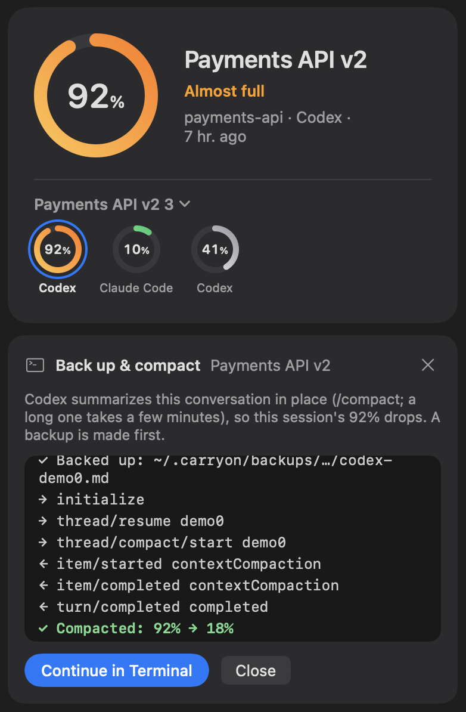

# CarryOn

English | [한국어](README.ko.md)

A free menu-bar app that shows every AI coding session on your Mac (Claude Code, Codex and Aside) and how full each one's
context is. When one is almost full, one button backs it up and compacts it, so you keep working where you left off.

**[Download CarryOn for Mac](https://github.com/morningverse67-wq/carryon-app/releases/latest/download/CarryOn.dmg)**
· macOS 14 or later · Apple silicon and Intel · [Website](https://carryon-app.pages.dev/)

<picture>
  <source media="(prefers-color-scheme: dark)" srcset="docs/img/en-wide-dark.webp">
  
</picture>

- **One list of what needs you.** Waiting for your answer, needs continuing (context 60% or more, orange from 85%) and
  running, each session once; the selected session's card shows the sessions in its group (those that handed each
  other work) as rings. A notification comes when one gets almost full.
- **Back up & compact.** Backs the conversation up, then compacts it in place so its % drops. The app runs it in a panel
  and shows each step and how long it took. An Aside session goes on in a fresh one.

  

- **Clean Up Sessions.** Closes the Claude Code sessions left idle in a terminal, with the memory they hold, after you
  confirm (the conversation stays and can be resumed), and lists the sessions that read the most tokens in 24 hours,
  ready to compact.
- **Your to-dos come along.** Keep a to-do list per session; the open ones follow it after a compaction.
- In English, Korean, Japanese and Simplified Chinese.

## First launch

CarryOn is not notarized by Apple yet, so macOS asks once before it opens:

1. Open the `.dmg` and drag **CarryOn** into **Applications**.
2. Open the app. macOS says it can't verify it; that is expected for now. Click **Done**.
3. Go to **System Settings → Privacy & Security**, scroll down, click **Open Anyway** and confirm.

Or run this once in Terminal: `xattr -dr com.apple.quarantine "/Applications/CarryOn.app"`

There is no Dock icon: CarryOn lives in the menu bar.

## Privacy

- CarryOn reads the session logs already on your Mac and makes no network connections itself.
- Message bodies are never shown in full, stored or sent anywhere.
- Only **Back up & compact** (or **Back up & start fresh**) copies that one session's log to `~/.carryon/backups/` and runs
  the tool's own `/compact` (claude or codex): as when you type `/compact` yourself, the summary is added to that session's
  log and the conversation goes to your model provider.

## License

Free to use. The source code is not public. See [LICENSE](LICENSE).
