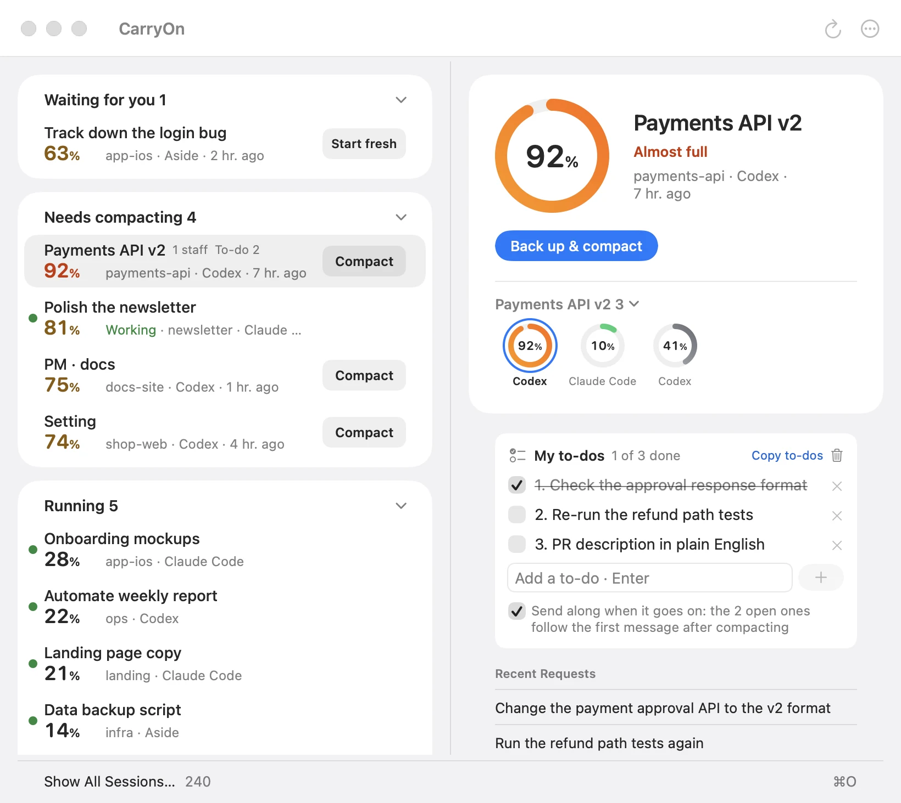
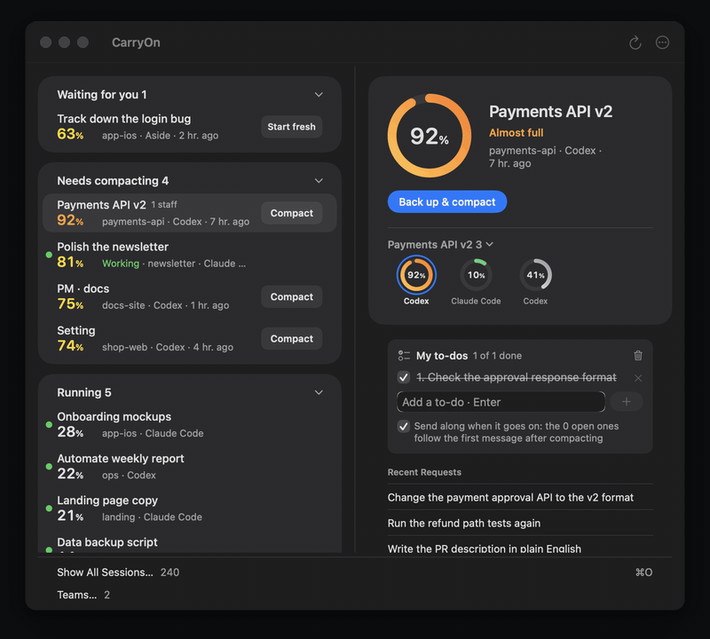

# CarryOn

English | [한국어](README.ko.md)

A free menu-bar app that shows every AI coding session on your Mac (Claude Code, Codex, Aside and Gemini CLI) and how full each one's
context is. When one is almost full, one button backs it up and compacts it, so you keep working where you left off.

**New:** CarryOn for iPhone is on the App Store.

**Download:** [Mac](https://carryon-app.pages.dev/download?s=github) · [Windows (Microsoft Store)](https://carryon-app.pages.dev/download/windows?s=github) · [iPhone (App Store)](https://apps.apple.com/app/id6831468074?ct=github) · [Android (beta testers wanted)](https://carryon-app.pages.dev/?lang=en&s=github#android) · [Website](https://carryon-app.pages.dev/?lang=en&s=github)

- Mac: macOS 14 or later, Apple silicon and Intel
- Windows: Windows 10 1903 or later, x64. From the Microsoft Store
- iPhone: iOS 15 or later. The phone app needs CarryOn on your computer
- Android (closed beta on Google Play): Android 7 or later. To join, DM your Gmail address to [@carryon__app on X](https://x.com/carryon__app);
  once you are on the list, [join the test here](https://play.google.com/apps/testing/io.github.carryon.phone). The beta APK is also [here](https://carryon-app.pages.dev/download/android?s=github)

<picture>
  <source media="(prefers-color-scheme: dark)" srcset="docs/img/en-wide-dark.webp">
  
</picture>

- **One list of what needs you.** Waiting for your answer, needs compacting (context 60% or more in yellow, orange from
  85%) and running, each session once, on cards. The selected session's card shows its group as rings: a session that
  handed out work and the sessions it handed work to, named after the first. The group's name is a menu of every group,
  the fullest first. A notification comes when one gets almost full.
- **Back up & compact.** Backs the conversation up, then compacts it in place so its % drops. The app runs it in a panel
  and shows each step and how long it took. An Aside or Gemini CLI session goes on in a fresh one.
  CarryOn never closes a running session or opens it again in a new window. Turn on **Tidy up automatically when full**
  in Settings and Claude Code and Codex compact a session themselves at the red line, right where it runs: CarryOn writes
  that one value into their own settings and puts back what was there when you turn it off. A session that is working
  gets **Tidy up when done**: it is compacted once it stops, with a notification.

  

- **Start fresh in Orca.** On Claude Code (or Codex) running in an Orca pane, **Back up & start fresh** backs it up and
  types `/clear` (Codex: `/new`) and then the go-on message there, so it goes on in a fresh session in the same pane.
  CarryOn types into a running session only then: when you press it, while the session is idle with an empty input line.
- **Clean Up Sessions.** Closes the Claude Code sessions left idle in a terminal, with the memory they hold, after you
  confirm (the conversation stays and can be resumed), and lists the sessions that read the most tokens in 24 hours,
  each ready to compact right in its row.
- **Your to-dos come along.** Keep a to-do list per session; the open ones follow it after a compaction.
- **Rename a session.** Right-click it and choose Rename…; the name is kept in CarryOn only.
- **Roles and teams.** Set Role… gives a session a role that goes along in the go-on message and the Resume brief;
  Name Team… names a group, and Teams… shows every team with its members' roles. Kept in CarryOn only.
- **In the menu bar.** Click CarryOn there to open the window. Right-click it for the three fullest sessions, Settings
  and Check for Updates, which opens the releases page in your browser.
- In English, Korean, Japanese, Simplified Chinese, German, French, Spanish, Italian, Dutch and Portuguese (Brazil).

## Install

The quickest way is one line in Terminal. It downloads the newest release, checks its SHA-256 against the release,
quits a running CarryOn and puts the app into Applications, with no Open Anyway step
([read it first](https://carryon-app.pages.dev/install.sh)):

```sh
curl -fsSL https://carryon-app.pages.dev/install.sh | sh
```

Or download the `.dmg`. CarryOn is not notarized by Apple, so macOS asks once before it opens:

1. Open the `.dmg` and drag **CarryOn** into **Applications**.
2. Open the app. macOS says it can't verify it; that is expected. Click **Done**.
3. Go to **System Settings → Privacy & Security**, scroll down, click **Open Anyway** and confirm.

There is no Dock icon: CarryOn lives in the menu bar.

## Privacy

- CarryOn reads the session logs already on your Mac and, by default, makes no network connections itself.
- If you turn on **Phone link**, it talks, encrypted, only to phones you paired on the same network, and sends only
  session names, how full they are and their state, never your conversations.
- Message bodies are never shown in full, stored or sent anywhere.
- Only **Back up & compact** (or **Back up & start fresh**) copies that one session's log to `~/.carryon/backups/` and runs
  the tool's own `/compact` (claude or codex): as when you type `/compact` yourself, the summary is added to that session's
  log and the conversation goes to your model provider.
- In an Orca pane, **Back up & start fresh** reads that pane's screen through Orca's own CLI, to see that the session is
  idle with an empty input line, before it types anything there.

## License

CarryOn is free to use, but it is not open source. You may not copy, redistribute, modify or sell it; see [LICENSE](LICENSE). "CarryOn" and the otter icon are trademarks of morningverse.
