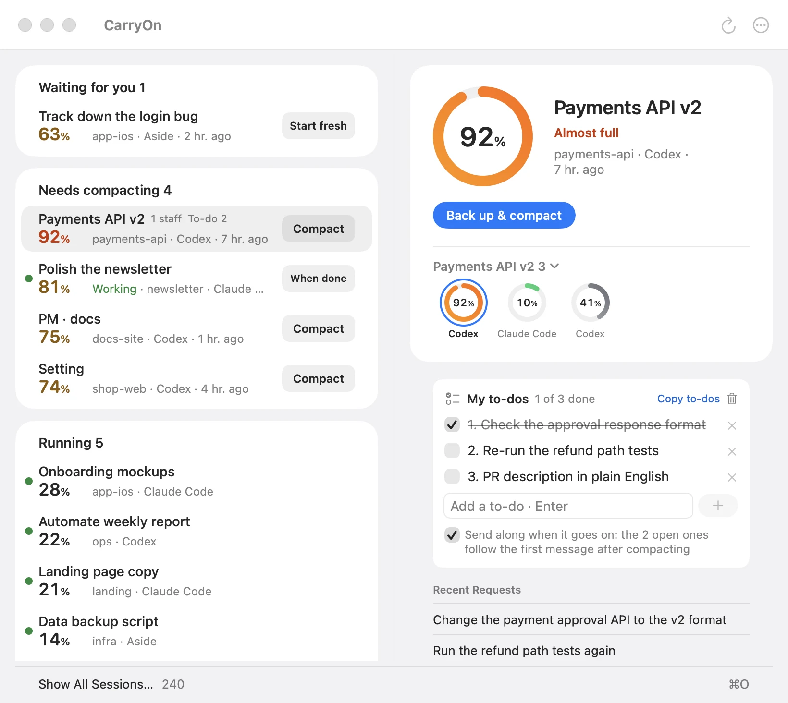
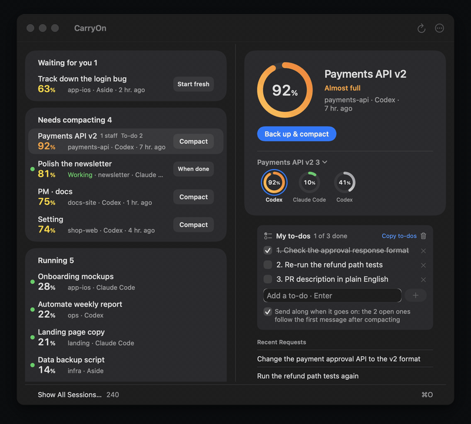

# CarryOn

English | [한국어](README.ko.md)

A free menu-bar app that shows every AI coding session on your Mac (Claude Code, Codex and Aside) and how full each one's
context is. When one is almost full, one button backs it up and compacts it, so you keep working where you left off.

**[Download CarryOn for Mac](https://carryon-app.pages.dev/download)**
· macOS 14 or later · Apple silicon and Intel · [Website](https://carryon-app.pages.dev/?lang=en)

<picture>
  <source media="(prefers-color-scheme: dark)" srcset="docs/img/en-wide-dark.webp">
  
</picture>

- **One list of what needs you.** Waiting for your answer, needs compacting (context 60% or more in yellow, orange from
  85%) and running, each session once, on cards. The selected session's card shows its group as rings: a session that
  handed out work and the sessions it handed work to, named after the first. The group's name is a menu of every group,
  the fullest first. A notification comes when one gets almost full.
- **Back up & compact.** Backs the conversation up, then compacts it in place so its % drops. The app runs it in a panel
  and shows each step and how long it took. An Aside session goes on in a fresh one.
  A Claude Code session idle in a terminal gets **Close & compact**: after you confirm, CarryOn closes it, compacts it
  and opens it again in Terminal. A session that is working gets **Tidy up when done** instead: it is compacted once
  it stops, with a notification. Turn on **Tidy up automatically when full** in Settings and a running session that
  reaches the red line is set for it by itself.

  

- **Clean Up Sessions.** Closes the Claude Code sessions left idle in a terminal, with the memory they hold, after you
  confirm (the conversation stays and can be resumed), and lists the sessions that read the most tokens in 24 hours,
  each ready to compact right in its row.
- **Your to-dos come along.** Keep a to-do list per session; the open ones follow it after a compaction.
- **Rename a session.** Right-click it and choose Rename…; the name is kept in CarryOn only.
- **In the menu bar.** Click CarryOn there to open the window. Right-click it for the three fullest sessions, Settings
  and Check for Updates, which opens the releases page in your browser.
- In English, Korean, Japanese and Simplified Chinese.

## Install

The quickest way is one line in Terminal. It downloads the newest release, checks its SHA-256 against the release,
quits a running CarryOn and puts the app into Applications, with no Open Anyway step
([read it first](https://carryon-app.pages.dev/install.sh)):

```sh
curl -fsSL https://carryon-app.pages.dev/install.sh | sh
```

Or download the `.dmg`. CarryOn is not notarized by Apple, so macOS asks once before it opens:

1. Open the `.dmg` and drag **CarryOn** into **Applications**.
2. Open the app. macOS says it can't verify it; that is expected. Click **Done**.
3. Go to **System Settings → Privacy & Security**, scroll down, click **Open Anyway** and confirm.

There is no Dock icon: CarryOn lives in the menu bar.

## Privacy

- CarryOn reads the session logs already on your Mac and makes no network connections itself.
- Message bodies are never shown in full, stored or sent anywhere.
- Only **Back up & compact** (or **Back up & start fresh**) copies that one session's log to `~/.carryon/backups/` and runs
  the tool's own `/compact` (claude or codex): as when you type `/compact` yourself, the summary is added to that session's
  log and the conversation goes to your model provider.

## License

CarryOn is free to use, but it is not open source. You may not copy, redistribute, modify or sell it; see [LICENSE](LICENSE). "CarryOn" and the otter icon are trademarks of morningverse.
